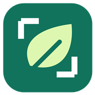
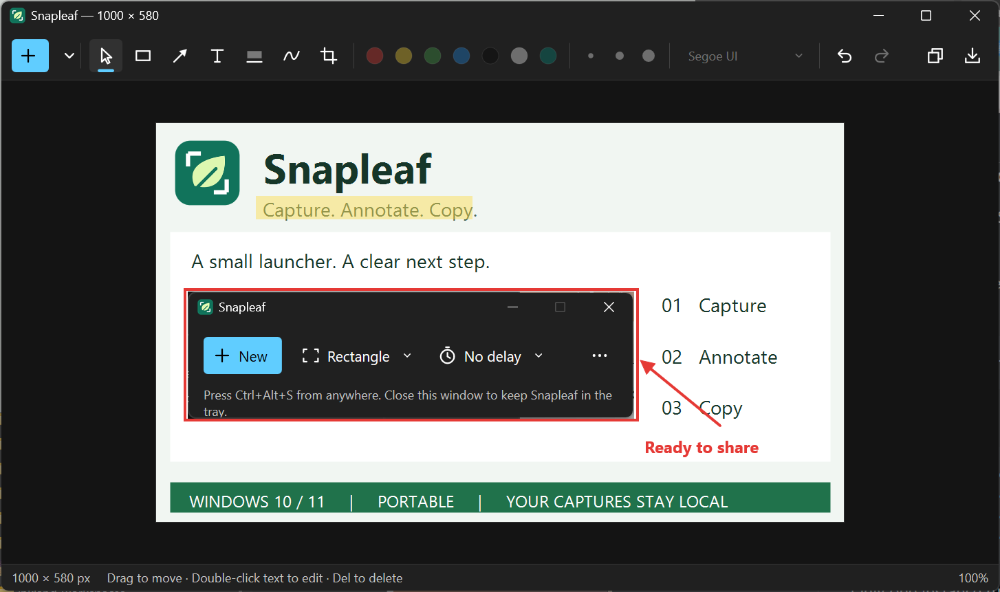
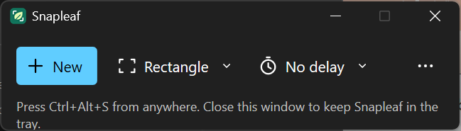
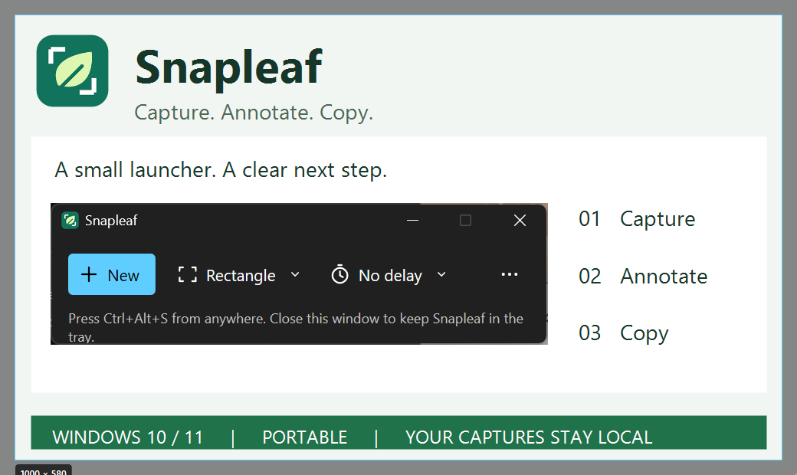

<p align="center">
  
</p>

# Snapleaf

A tiny screenshot and markup tool for Windows. **Capture, annotate, copy.**

Snapleaf captures a rectangle, a window, or your full screen, then opens it in an editor.
Add arrows, text, rectangles, highlights and freehand marks, or crop the image before sharing.
Captures stay on your computer.



## Download

Get the Windows x64 executable or portable ZIP from [Releases](https://github.com/shyoo/snapleaf/releases).
Extract the ZIP and run **snapleaf.exe**. No installer or separate runtime is needed.
Requires Windows 10 or 11.

Development builds are available as `snapleaf-windows-x64` artifacts on successful
[Actions runs](https://github.com/shyoo/snapleaf/actions/workflows/release.yml)
(sign in to GitHub to download them).

## Capture

Open Snapleaf and click **New**, or press **Ctrl+Print Screen**. Choose Rectangle, Window,
or Full screen, with an optional 3, 5, or 10 second delay. Drag to select a rectangle;
press **Esc** or right-click to cancel.





Snapleaf supports multiple monitors and different display scales. Its launcher and editors
hide during capture, then return afterward. Closing the launcher keeps it in the notification
area; use **Exit Snapleaf** in the tray menu to quit. Change the global shortcut from **⋯**.

## Annotate and share

The fresh capture is copied automatically. Add your markup, then press **Ctrl+C** to copy
the updated image or **Ctrl+S** to save a PNG. Paste into chat, email, documents, or a browser.

Shapes remain editable: select one to move, resize, recolour, or delete it. Double-click text
to edit it. Text supports font choices, bold, italic, and IME input.

| Shortcut | Action |
| --- | --- |
| V / R / A / T / H / P / C | Select / rectangle / arrow / text / highlight / pen / crop |
| Ctrl+C / Ctrl+S | Copy image / save PNG |
| Ctrl+Z / Ctrl+Y | Undo / redo |
| Delete / arrow keys | Delete / nudge selection (Shift for 10 pixels) |
| Shift while drawing | Square rectangles / 45° arrows |
| Ctrl+wheel / Ctrl+0 / Ctrl+1 | Zoom / fit / actual size |
| Space+drag / middle-drag | Pan |
| Ctrl+B / Ctrl+I | Bold / italic text |
| Ctrl+N / Ctrl+W | New capture / close editor |

## Build from source

Install the Rust MSVC toolchain and Visual Studio C++ build tools, then run:

```powershell
cargo build --release --locked
.\target\release\snapleaf.exe
```

See [development and release instructions](docs/development.md) for packaging, automation,
and contributor details.

## License

Copyright 2026 Sunghwan Yoo. Licensed under the [Apache License 2.0](LICENSE).
